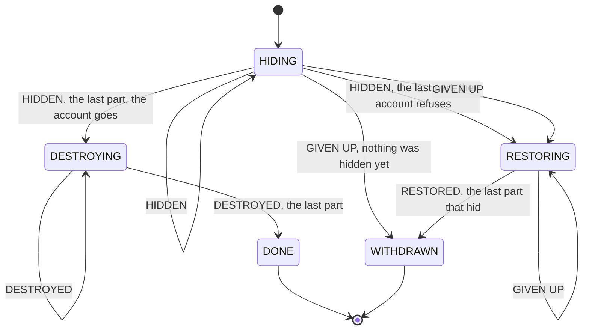

# account-closure-2

The runner for [`../specs-2`](../specs-2/README.md): the portal's promises about letting go of a
person's content, stated before anybody decides what the portal is built of.

It is the second runner over the same two subjects as `portal-specs`, and it is not its successor.
The two answer different questions and both answers are worth having:

|  | `portal-specs` | here |
|---|---|---|
| assumes | the design: a thing that commands the parts, collects their answers, waits, gives up | nothing |
| builds | the real router and the real three participants, plus their adapters' stand-ins | the ports, the fakes beside them, and the use cases |
| depends on | `*-application`, `*_account-closure`, `offboarding-*` | `*-domain` + `*-system`, and nothing above them |
| costs | ~5000 lines of Java under 312 lines of Gherkin | ~2000 under 275 lines of Gherkin and one drawing |

That dependency line is the whole constraint, and it is what shaped the module: a suite that may
not reach above `*-system` cannot borrow anybody's orchestration, so it has to say out loud what it
is standing in for.

## What stands in for what

- **`world.ClosureProtocol`** — the closure as a state machine, drawn below under
  [The closure protocol](#the-closure-protocol). `ClosureProtocolTest` reads the arrows out of
  that drawing and holds the class to them, so the picture cannot go stale without the build
  failing. `../specs-2` borrows the state names ("Given the closure has reached DESTROYING"). It
  is the PROTOCOL and not the transport: a monolith keeps it inside one transaction, separate
  services keep it with a saga, and the same scenarios are meant to run against either. What
  carries a report, how long anybody waits for a part and who gives up are outside it on purpose.
- **`world.Closures`** — this suite's own `ContentPurge`, which is what `StartAccountDeletion` hands
  a closure to. It reads the leaver's id off the account row ONCE and keeps it, because destroying
  happens after the account is gone and there is then no row left to read it from.
- **`world.Accounts`** — `FakeUserRepository` with one switch in front of it: an account that
  refuses to be deleted. The scenario the whole order exists for needs one.
- **`world.MemeAnnouncements` / `world.CommentAnnouncements`** — what one part told the others,
  written down, so a step can say "memes announced" and a later step "collections has heard", and
  the two are visibly different moments. Not fakes of the ports: this is the suite's own wiring.

Everything else is the real thing. The use cases are `memes-system`, `comments-system`,
`collections-system` and `security-system`'s own; the stores are the fakes published beside their
ports as test-jars; `DeleteAccount` is handed all nine repositories it names, because none of those
tables has a foreign key and whatever is not named outlives the account.

Two ports stay on Mockito — `TagRepository` and `MemeContentIndex` — by the verdict of 2026-09-28:
what they hide is one service's own promise, a level below anything these files state.

## The closure protocol

Something has to notice that every part has hidden its share and only then let the account go;
something has to know the account is gone before any part destroys anything, and know it stayed
before any part brings anything back. This is that something, as small as it can be: five states,
three reports a part can make, and the picture below of which state takes which. A monolith keeps
it inside one transaction, where a refused report is a rollback; separate services keep it with a
saga, where a refused report is a message nobody acts on.



The picture is the test's input, not its illustration: `ClosureProtocolTest` reads the arrows out
of this file (the label up to the first comma is the report, the rest is for the reader). An arrow
out of a state is a report that state takes; a report with no arrow is refused and changes
nothing; and every arrow drawn is walked by a test, so the picture and `ClosureProtocol` cannot
drift apart without the build saying so.

What the picture does not carry, and the same test states in code:

- "the last part" is the third of memes, comments and collections, and the same report twice from
  one part is nothing new;
- the account is asked to go once, at the last HIDDEN, and is unlocked whenever the closure turns
  back;
- in RESTORING only a part that hid has anything to restore: RESTORED from any other part is
  refused, and WITHDRAWN comes when every part that hid has restored.

## The two rules the step definitions keep

**One step is one piece of work OR one assertion, never both.** No `When` moves the chain along and
checks something at the same time, and none quietly does two parts' work. The one licence is a
`Given`: "the closure has reached DESTROYING" plays every part's hide and the account's going
through the real use cases, because the moments in between are what the drawing above is
about, and a scenario in `../specs-2` starts where its own claim starts. Without that split an
order the files promise could be broken by the code and the files would still pass, because nothing
would ever observe the moment in between.

**An assertion reads a fake directly**, with no helper layer between a `Then` and
`FakeMemeErasure` / `FakeCommentErasure` / `FakeCollectionRepository` / `FakeUserRepository`. And
**"gone" means "not in the store", never "the repository cannot see it"**: those repositories hide a
hidden row exactly as the deployed adapters' active views do, so an assertion written through
`find` or `findMetadata` would pass the moment something was HIDDEN and claim it had been
destroyed. Writing them the strict way immediately found a drift in two of the fakes — a destroyed
row left its mark behind in a map, which in the schema (where the status is a column of the row) can
never happen.

```bash
../mvnw -f pom.xml clean test
```
